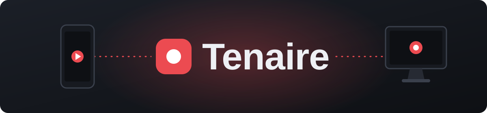
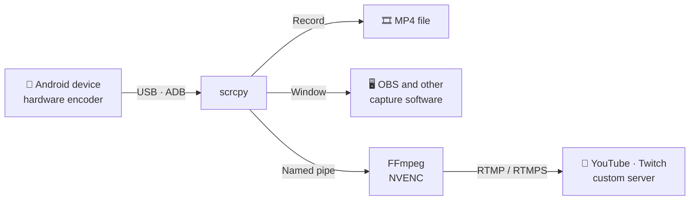

<div align="center">



### Mirror, record and live-stream your Android screen on Windows over a single USB cable.

[](https://github.com/necipdeveci/tenaire/releases/latest)


[](LICENSE)

**English** · [Türkçe](README.tr.md)

</div>

---

## 📱 About

Tenaire is a desktop application that turns a Windows PC into a capture station for an Android phone. Plug the phone in, pick a quality profile and start recording or streaming, all from one compact window.

Video is compressed by the phone's own hardware encoder, so the extra load on the device stays low. The connection is read-only: the phone stays in your hands and the PC never sends it any input.

> [!NOTE]
> The application interface is currently available in Turkish.

## 🎬 Modes

| Mode | What it does |
| :--- | :--- |
| **Record** | Saves video and device audio as MP4, and the microphone as a separate file so the two can be balanced and merged later. |
| **Live Stream** | Streams directly to YouTube, Twitch or any custom RTMP/RTMPS server, with an optional local copy. |
| **Window** | Opens a clean window for streaming software such as OBS to capture and plays device audio and the microphone on the PC, with optional recording at the same time. |

## ✨ Features

- 🎚️ **Three quality profiles** to balance sharpness against device heat
- 🎙️ **Flexible microphone input** from the phone, a wired headset or any PC input device, with optional echo cancellation for the phone microphone
- 🔊 **Audio control** with level meters, gain from −40 to +20 dB, microphone delay up to 5 seconds and a built-in audio test
- 🎞️ **Merging without quality loss** that mixes the microphone into the recording without re-encoding the video and leaves the original files untouched
- 🌡️ **Device monitoring** that shows live temperature and battery level, plus the temperature change since the session began
- 🔐 **Protected stream key** that is encrypted with Windows DPAPI and masked in error messages

### Quality profiles

| Profile | Longest edge | Frame rate | Bitrate | Best for |
| :--- | :---: | :---: | :---: | :--- |
| **Cool** | 1280 px | 30 fps | 8 Mbps | Long sessions with the least added heat |
| **Balanced** *(default)* | 1920 px | 60 fps | 16 Mbps | Sharp, smooth footage at a reasonable load |
| **Quality** | Native | 60 fps | 30 Mbps | The phone's full resolution |

## 🚀 Getting started

**Requirements**

- Windows 10 or later (64-bit)
- [.NET 10 Desktop Runtime](https://dotnet.microsoft.com/download/dotnet/10.0)
- An Android phone with USB debugging enabled
- Android 11 or later for the phone microphone, Android 13 or later for device audio
- An NVIDIA GPU with NVENC support for **Live Stream** mode

**Installation**

1. Download the latest `.zip` from the [Releases](https://github.com/necipdeveci/tenaire/releases/latest) page and extract it.
2. On the phone, enable **Developer options › USB debugging**.
3. Connect the phone with a USB cable and accept the authorization prompt.
4. Run `Tenaire.exe`. Keep the whole folder together, since the application needs the files next to it.

Recordings are saved to `Videos\Tenaire`.

## ⚙️ How it works



## 🛠️ Building from source

You will need the [.NET 10 SDK](https://dotnet.microsoft.com/download). The third-party engines are not stored in the repository because of their size, so create an `engine` folder in the project directory first:

1. Extract the Windows 64-bit package of [scrcpy 5.0.1](https://github.com/Genymobile/scrcpy/releases/tag/v5.0.1) directly into `engine`. You should end up with `engine\scrcpy.exe` and `engine\adb.exe`.
2. Download the `n9.0` `win64-lgpl-shared` package from [BtbN FFmpeg Builds](https://github.com/BtbN/FFmpeg-Builds/releases). Put the contents of its `bin` folder and its `LICENSE.txt` into `engine\ffmpeg`. You should end up with `engine\ffmpeg\ffmpeg.exe`.

FFmpeg has to stay in its own folder because scrcpy ships DLLs with the same names from different builds.

```bash
dotnet publish Tenaire.csproj -c Release -o dist
```

The application is created at `dist\Tenaire.exe`.

## 🙏 Built with

- [scrcpy](https://github.com/Genymobile/scrcpy) (Apache 2.0) for screen and audio capture
- [FFmpeg](https://ffmpeg.org) (LGPL) for live streaming and audio merging

## 📄 License

Tenaire's source code is released under the [MIT License](LICENSE). scrcpy and FFmpeg are subject to their own licenses.
