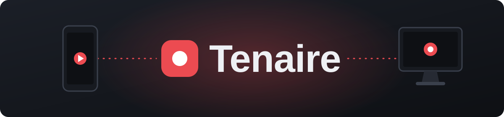
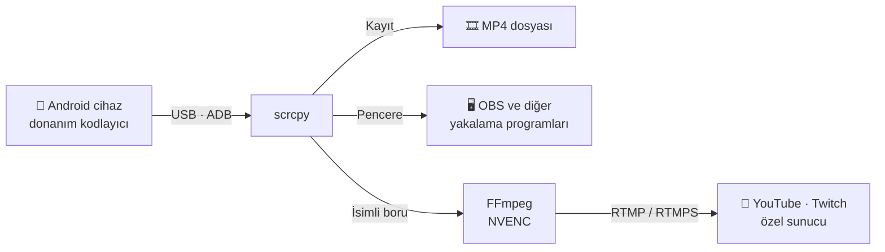

<div align="center">



### Android ekranınızı tek bir USB kabloyla Windows'ta yansıtın, kaydedin ve canlı yayınlayın.

[](https://github.com/necipdeveci/tenaire/releases/latest)


[](LICENSE)

[English](README.md) · **Türkçe**

</div>

---

## 📱 Hakkında

Tenaire, bir Windows bilgisayarı Android telefon için kayıt ve yayın istasyonuna dönüştüren masaüstü uygulamasıdır. Telefonu takın, bir kalite profili seçin ve tek bir kompakt pencereden kayda veya yayına başlayın.

Görüntü telefonun kendi donanım kodlayıcısıyla sıkıştırıldığı için cihaza binen ek yük düşük kalır. Bağlantı salt okunurdur: telefon elinizde kalır, bilgisayar telefona hiçbir komut göndermez.

## 🎬 Modlar

| Mod | Ne yapar |
| :--- | :--- |
| **Kayıt** | Görüntüyü ve cihaz sesini MP4 olarak, mikrofonu ise ayrı dosya olarak kaydeder. Böylece ikisi sonradan dengelenip birleştirilebilir. |
| **Canlı Yayın** | YouTube, Twitch veya herhangi bir özel RTMP/RTMPS sunucusuna doğrudan yayın yapar, isteğe bağlı olarak bilgisayara da kaydeder. |
| **Pencere** | OBS gibi yayın programlarının yakalaması için temiz bir pencere açar, cihaz sesini ve mikrofonu bilgisayardan çalar, isteğe bağlı olarak aynı anda kayıt alır. |

## ✨ Özellikler

- 🎚️ **Üç kalite profili** ile netlik ve cihaz ısınması arasında denge
- 🎙️ **Esnek mikrofon girişi:** telefon, kablolu kulaklık veya bilgisayardaki herhangi bir giriş aygıtı, telefon mikrofonu için isteğe bağlı yankı engelleme
- 🔊 **Ses kontrolü:** seviye göstergeleri, −40 ile +20 dB arası kazanç, 5 saniyeye kadar mikrofon gecikmesi ve yerleşik ses testi
- 🎞️ **Kalite kaybı olmadan birleştirme:** mikrofon, görüntü yeniden kodlanmadan kayda karıştırılır, orijinal dosyalar değişmez
- 🌡️ **Cihaz takibi:** anlık sıcaklık ve pil seviyesi, oturum başından beri sıcaklık değişimi
- 🔐 **Korunan yayın anahtarı:** Windows DPAPI ile şifrelenir, hata mesajlarında gizlenir

### Kalite profilleri

| Profil | En uzun kenar | Kare hızı | Bit hızı | Kullanım |
| :--- | :---: | :---: | :---: | :--- |
| **Serin** | 1280 px | 30 fps | 8 Mbps | En az ek ısınmayla uzun oturumlar |
| **Dengeli** *(varsayılan)* | 1920 px | 60 fps | 16 Mbps | Makul yükle net ve akıcı görüntü |
| **Kalite** | Tam | 60 fps | 30 Mbps | Telefonun tam çözünürlüğü |

## 🚀 Başlarken

**Gereksinimler**

- Windows 10 veya üzeri (64 bit)
- [.NET 10 Masaüstü Çalışma Zamanı](https://dotnet.microsoft.com/download/dotnet/10.0)
- USB hata ayıklaması açık bir Android telefon
- Telefon mikrofonu için Android 11 veya üzeri, cihaz sesi için Android 13 veya üzeri
- **Canlı Yayın** modu için NVENC destekli bir NVIDIA ekran kartı

**Kurulum**

1. [Sürümler](https://github.com/necipdeveci/tenaire/releases/latest) sayfasından en güncel `.zip` dosyasını indirip bir klasöre çıkarın.
2. Telefonda **Geliştirici seçenekleri › USB hata ayıklama** ayarını açın.
3. Telefonu USB kabloyla bağlayın ve çıkan izin penceresini onaylayın.
4. `Tenaire.exe` dosyasını çalıştırın. Uygulama yanındaki dosyalara ihtiyaç duyduğu için klasörü bütün olarak tutun.

Kayıtlar `Videolar\Tenaire` klasörüne kaydedilir.

## ⚙️ Nasıl çalışır



## 🛠️ Kaynak koddan derleme

[.NET 10 SDK](https://dotnet.microsoft.com/download) gereklidir. Üçüncü taraf motorlar boyutları nedeniyle depoda bulunmaz, bu yüzden önce proje klasöründe bir `engine` klasörü oluşturun:

1. [scrcpy 5.0.1](https://github.com/Genymobile/scrcpy/releases/tag/v5.0.1) Windows 64 bit paketinin içeriğini doğrudan `engine` klasörüne çıkarın. `engine\scrcpy.exe` ve `engine\adb.exe` oluşmalıdır.
2. [BtbN FFmpeg Builds](https://github.com/BtbN/FFmpeg-Builds/releases) sayfasından `n9.0` sürümünün `win64-lgpl-shared` paketini indirin. Paketin `bin` klasöründeki dosyaları ve `LICENSE.txt` dosyasını `engine\ffmpeg` klasörüne koyun. `engine\ffmpeg\ffmpeg.exe` oluşmalıdır.

scrcpy aynı adlı ama farklı derlemelerde DLL dosyaları kullandığı için FFmpeg'in ayrı klasörde durması gerekir.

```bash
dotnet publish Tenaire.csproj -c Release -o dist
```

Uygulama `dist\Tenaire.exe` olarak oluşur.

## 🙏 Kullanılan bileşenler

- [scrcpy](https://github.com/Genymobile/scrcpy) (Apache 2.0): ekran ve ses yakalama
- [FFmpeg](https://ffmpeg.org) (LGPL): canlı yayın ve ses birleştirme

## 📄 Lisans

Tenaire'in kaynak kodu [MIT lisansı](LICENSE) ile dağıtılır. scrcpy ve FFmpeg kendi lisanslarına tabidir.
